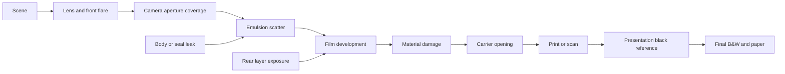

# Darkroom: seeded distress and light-leak contract

Research reviewed 2026-11-10. This is the proposed next implementation, not a shipped effects collection. The portrait/print-orientation and negative-print black-opening corrections are implemented separately; their verification lives in WORKFLOW.md. Keep real phone photographs, backups and diagnostic previews outside this repository.

## Direction

Use continuous physical coordinates and separate procedural nodes for mechanical shape, material damage and unwanted exposure. A single random RGB texture cannot represent all three. Start with clean output at Strength 0, a saved seed and one restrained carrier treatment; add the other mechanisms only after their stage and polarity tests pass. Keep Auto/Manual material selection unrestricted and B&W as the final conversion.

The 135 aperture stays 36×24 mm and the first 120 aperture stays 56×56 mm. Distress perturbs a boundary by a bounded physical displacement; it does not change the nominal crop ratio or stretch sprockets. The measured KS dimensions and 4.750 mm pitch remain the clean reference. Factory perforations must not acquire random damage merely because the carrier is distressed.

## Evidence and what it supports

| Primary reference | Finding relevant to this design | Limit |
| --- | --- | --- |
| [Kodak: Handling of Processed Film](https://www.kodak.com/en/motion/page/handling-of-processed-film/) | Surface damage depends on transport, handling, depth and side. Damage can affect geometry, transmission or scattering. | A projected print example does not determine the appearance of the same defect in an inverted camera-negative scan. |
| [Kodak: Turbulation Troubleshooting](https://www.kodak.com/en/motion/page/turbulation-troubleshooting-guide/) | Uneven processing can produce spatially varying development. | This does not justify treating a development defect as a light leak. |
| [Kodak: Shoreline Effects](https://www.kodak.com/en/motion/page/shoreline-effects/) | Drying near slit edges and perforations differs from drying across the emulsion surface. | This supports edge-conditioned structure, not a calibrated RGB shoreline preset. |
| [ILFORD: Common Processing Problems](https://www.ilfordphoto.com/common-film-processing-problems/) | Incomplete processing and surface drying marks have different causes and signatures. | Black-and-white examples do not supply color-layer coefficients. |
| [Lomography: Redscale film guide](https://www.lomography.com/magazine/354958-guide-to-lomography-color-shifting-film-stocks-lomography-redscale) | Rear-side exposure can favor warm/red response; exposure affects the result. | A redscale stock or whole-frame experiment is not a calibrated camera-seal leak model for every stock. |
| [CineStill: What is Remjet?](https://help.cinestillfilm.com/hc/en-us/articles/360028874012-What-is-Remjet) | The backing influences several film behaviors; stock construction matters. | Do not apply one backing model to all cinema-derived or still films. |
| [Kodak: fog appearance by film type](https://kodakassist.freshdesk.com/support/solutions/articles/48001070088-how-does-baggage-x-ray-scanning-effect-my-film-) | Negative and reversal media respond differently to unwanted exposure. | The article describes radiation fog. It is evidence about response polarity, not an optical leak shape or spectral model. |
| [ComfyUI-Darkroom, pinned `69612f0`](https://github.com/jeremieLouvaert/ComfyUI-Darkroom/blob/69612f04b2481dc0d0e45c9c7784d0e8a6d7be45/nodes/film_rebate.py) | A seeded low-frequency carrier perimeter is a useful procedural starting point. | Its decorative RGB composition and unverified placement assumptions do not replace our physical support/optical contract. |
| [Cook & DeRose: Wavelet Noise](https://graphics.pixar.com/people/derose/publications/WaveletNoise/paper.pdf) | Procedural texture needs explicit frequency/footprint control to avoid aliasing and disappearing detail. | Resolution invariance is not established merely by using a deterministic random generator. |

The node choices, equations, tentative ranges and controls below are engineering proposals inferred from these mechanisms. No calibrated real-scan match is claimed.

## Physical coordinates and seed behavior

Maintain a canonical film coordinate system: `s` follows transport and `t` runs across the stock. Convert pixel centers through the existing film geometry into millimetres, using an explicit rotation matrix for portrait presentation. A plain x/y swap would mirror an asymmetric pattern. Image reframing changes scene placement inside the aperture; it must not shuffle the virtual camera's wear pattern.

Define a field as `F(s_mm, t_mm, seed, nodeID, featureID)`. Derive independent streams for carrier, camera, scratches and leaks from a saved 32-bit master seed. Do not seed from image width, height, output format, UIKit points, export size, crop origin or paper Scale. Save the algorithm revision too, so a later hash/noise update cannot silently change an existing edit.

Generate feature positions and physical dimensions from the seed. Strength changes their amplitude or exposure continuously; it must not regenerate their positions. If a later density control adds features, use stable candidate features with smooth activation. The dice action is the explicit way to choose a new pattern. A Strength drag remains one Undo group.

135 and 120 share units, not stretched textures. A 0.05 mm nick stays 0.05 mm on either format; the larger perimeter can contain more features at the same features/mm density. Format-specific distributions may later describe different camera/carrier populations, but require references. 120 never gets a sprocket-periodic pattern.

1080 and 4160 should sample the same continuous field. Pixel values need not be identical: features smaller than a pixel need area coverage or filtering. Filter octaves using the physical pixel footprint and integrate narrow scratches before nonlinear development when possible. Do not increase physical amplitude to make a defect survive at 1080. Downsampled 4160 coverage and independently rendered 1080 coverage must agree within a declared tolerance. The existing resolution-dependent grain sampler is a separate limitation; it is not evidence that the new distress field can reshuffle.

For the current 135 carrier width of 37.6 mm, 1080 pixels correspond to about 0.0348 mm/pixel and 4160 to 0.00904 mm/pixel. A 0.1 mm bump spans about 2.87 versus 11.06 pixels, while remaining the same film defect. The 57.6 mm 120 carrier has different pixel footprints at the same export width. These are coordinate calculations, not measured wear sizes.

## Nodes and where they belong

| Node | Proposed representation | Correct stage |
| --- | --- | --- |
| Filed carrier | Smooth perimeter displacement plus sparse rounded notches, in mm; a bounded signed-distance opening. | After film development, in printing/viewing coverage. It reveals or hides existing material and must not create camera halation. |
| Camera-aperture irregularity | Separate, usually smaller perimeter field; optional occluding dust fibres. | Exposure coverage after lens optics and before emulsion scatter. Its inward/outward features affect the captured image boundary. |
| Transport scratches | Sparse elongated paths along `s`, slowly wandering in `t`; width, depth and interruptions in physical units. | Emulsion removal modifies dye/layer density; base-side damage requires an optical transmission/scatter approximation. Neither belongs in camera-gate exposure. |
| Development streaks | Correlated low-frequency variation in local development, with anisotropic transport structure. | During film development. First isolate an empirical local-development approximation before attempting reaction/diffusion behavior. |
| Drying/shoreline residue | Surface/transmission modulation conditioned on distance to stock edges or perforations. | After development, before scan/printing optics. It must not generate grain or dye in an open hole. |
| Light fog/leak | A nonnegative spatial exposure field with a defined entrance path and stock response. | Before development, independently of scene metering. This can alter the image, rebate and inter-frame region according to the path. |

The first visible “gate distress” control should default to **carrier** roughness: it gives a naturally imperfect framing silhouette without inventing camera exposure. Camera-aperture wear can be an advanced source later. Use separate internal parameters even if the first panel shows only Strength and Seed.

Tentative study bounds, not measured camera specifications: carrier displacement up to roughly 0.1–0.15 mm, with a blend of broad 0.5–3 mm variations and much sparser short notches. Begin below those maxima. Clamp the opening to the prepared support and avoid self-intersections, collapsed borders or accidental perforation resizing. Camera-aperture displacement needs its own smaller calibrated range. A larger reveal beyond prepared material requires a new render, rather than sampling imaginary film.

### First carrier field: concrete prototype

Use the signed distance `d0(s,t)` of the ideal carrier opening. A bounded displacement can be defined as `delta_mm = strength × amplitude_mm × tanh(sum(w_i × N_i(s/ell_i, t/ell_i, seed_i)))`. Each `ell_i` is in mm. Evaluate `d = d0 - delta_mm` and integrate its coverage over the physical pixel footprint. Sampling a continuous 2D field around the closed contour avoids an artificial seam at a perimeter wrap or mismatched corners.

Add sparse rounded notches as separately seeded physical events, rather than making every edge equally noisy. Keep feature centers fixed while Strength changes depth. Use integer seed/hash arithmetic on CPU and Metal; a large seed cast to Float would lose bits. Smooth physical fields can use float math with a declared numerical tolerance.

For cost, evaluate detailed noise only in a narrow band around the ideal carrier boundary; pixels far inside/outside take the fast coverage path. Strength 0 bypasses the node exactly. Keep displacement within prepared support, and include any required extra halo/support extent in memory admission. This prototype is a geometric design; choosing amplitudes does not calibrate a specific camera or filed carrier.

## Streaks: distinguish mechanisms and polarity

Start with restrained transport wear in the rebate. Use a stable sparse path set, not independent random pixels: long correlation along film travel, short correlation across it, irregular endpoints and a few interruptions. Gate distance can bias where wear occurs, but a strict digital clip at the image rectangle would look artificial. Allow a smooth physical falloff toward the image and keep a zero-strength identity.

A scratch's sign and color must follow the material and viewing route. Removing dye differs from scattering light at a base scratch. Development nonuniformity differs again. For negative-to-paper output, changing negative density can reverse the apparent brightness relative to a direct scan; reversal and cinema print-film views need their own tests. Keep these mechanisms separate from an optional creative tint.

Later pressure/reverse-wind or processing patterns may correlate with perforations on 135. A shared seed does not justify copying that periodicity onto 120. Drying residue can follow support edges and hole rims without pretending that a clear opening contains emulsion.

## Light leaks: entrance path first, color second

“Front is white; back is orange” is a useful visual tendency for some color-negative cases, not a universal material rule. The result depends on illumination, which layers the light reaches, backing, film response, exposure, printing/inversion and scan balance. Implement exposure fields and let the selected process produce color; do not screen-blend a white or orange bitmap over the finished picture.

1. **Through-lens veiling flare/front light:** add a broadband field in the lens/image-light path, then apply the camera aperture. It predominantly affects the image; subsequent emulsion scatter can reach the rebate. Neutral illumination may wash out a positive image, but neutrality is not guaranteed for every stock or illuminant.
2. **Body/seal edge leak:** add exposure after the camera aperture, using a slit or edge-source field. Use exponential or multi-lobe falloff in mm with low-frequency modulation along the seal, optional baffle shadows and an explicit side/location. This can reach both image and rebate. A very subtle edge-only version is a small physical penetration distance, not a fixed number of pixels.
3. **Rear/base-side leak:** add layer exposure from the reverse side, independently of lens blur, camera UV/IR filtration and front-side optical flare. A warm/red tendency is plausible for many color negatives. It needs stock-specific rear-response data or a clearly recorded empirical approximation.
4. **Roll-end/light piping:** a later roll-level field with continuity across neighbouring frames and wound layers. A convincing roll effect needs a roll seed/position model; one arbitrary gradient per image is insufficient.

For a field `L(s,t)`, express strength as exposure relative to a documented reference grey, such as `E_leak ∝ 2^EV × L`. Meter only the original scene. Do not let Auto exposure cancel the leak. Film sees the combined exposure before its nonlinear density response; at high strength the response should saturate through the model, not through an RGB opacity ceiling.

For rear leaks, the existing stock profiles provide front sensitivity, developed density/base and scan data, but not a complete undeveloped layer stack or measured rear illumination response. **Do not reuse the processed orange base spectrum as if it were a known pre-exposure rear filter.** Establish a per-stock calibration interface. Front-scene halation and rear exposure also need a deliberate ordering: do not send the rear leak through the scene lens or blindly reuse the same front-scatter kernel twice.

The first rigorous implementation should use matched Spektrafilm output. Keep Manual edge choices available. Define the projection into a preserved LUT/disabled/partial-Mix center before enabling image-wide rear leaks there; otherwise the edge and center could receive inconsistent exposures. This is an integration requirement, not a restriction on today's edge chooser.

## Film and output routes

- Color negative: increased exposure changes negative density; printing or inversion determines the positive appearance. Warm rear leakage must remain a calibrated response, not a universal orange constant.
- Reversal: fog can produce lower-density/light areas in a transparency. Test its actual positive curve; do not invert a negative leak overlay.
- Cinema: keep source-negative damage/exposure distinct from destination print-film damage and holes. Anti-halation/backing behavior belongs to the relevant stock, not the “cinema” label alone.
- B&W: retain the user's chosen edge family and apply the existing final monochrome conversion. A dedicated B&W chemical model remains separate work.
- Negative print presentation: clear openings now define an exact black endpoint after scan optics; intact rebate color is retained. This requested presentation reference does not claim that physical paper D-max has zero reflectance. Direct transmission views retain their clear-hole route.

## Controls, persistence and cost

Reuse the existing Darkroom inspector and NumericControl. Default all new effects off. A compact Distress section can show Type, Strength, and a seed value/dice action; advanced physical width/scale controls stay collapsed. Separate Streaks and Leaks when their mechanisms are implemented, rather than putting every defect into one ambiguous slider. Leak choices should name the entrance path. Do not add dead placeholder controls to the app.

Optional saved settings should include algorithm revision, master seed, independent node strength and necessary physical parameters. Cache source decode separately from distress. Camera shape/leaks invalidate the film result; carrier coverage can reuse developed material only where that material exists; paper Scale stays outside those keys. Keep the existing one-active/latest-request scheduler and memory admission. Preview at 720, refine at the configured maximum and preserve seeds through export, Undo and reopening.

## Acceptance sequence

1. Carrier field first: zero-strength pixel identity; bounded geometry; fixed nominal aperture; stable seeded positions; independent format behavior; 1080/4160 coverage agreement; no hole deformation.
2. Camera-aperture field: bright steps/points with halation on/off and explicit separation from carrier-only roughness.
3. Rebate scratches/streaks: negative print, negative scan, reversal and cinema polarity; no material in holes; no temporal/strength popping.
4. Subtle edge fog, then front and rear entrance models: scene-only metering, exposure sweeps, stock response, crop/rotation and B&W. Compare controlled scans with known film, exposure path, process and scan settings before claiming calibration.
5. Phone interaction and memory: entry, continuous Strength drag, seed changes, cancellation, refinement and native export. Do not infer phone latency from desktop timings.

No seeded distress or leak controls are shipped by this research step. The next concrete implementation is the restrained carrier node, after this contract is reviewed alongside references and a physical-coordinate coverage proof.

## Controlled reference set before calibration

Use a scanner or camera-scanning setup with fixed illumination, magnification, inversion and tone settings. Include unexposed processed film, clear perforations, neutral references and an undeformed carrier measurement. Record pixel-to-mm calibration. For leaks, photograph capped/black frames and uniform grey exposures with controlled front/body/rear entry paths, several exposure strengths and known stock/process/backing. Keep automatic scan corrections off or record them. For scratches, record which side and approximate depth; for streaks, record processing and transport conditions. Treat uncontrolled online scans as visual examples, not enough information to identify a unique cause or fit physical coefficients.
